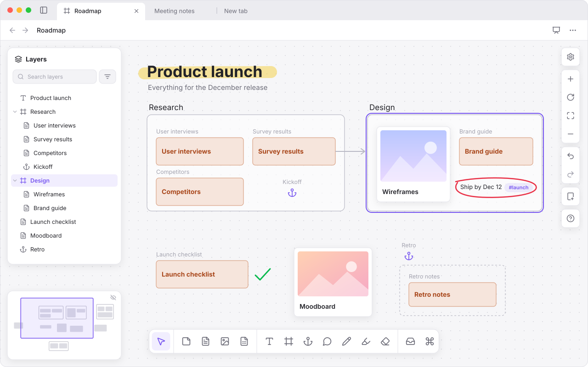
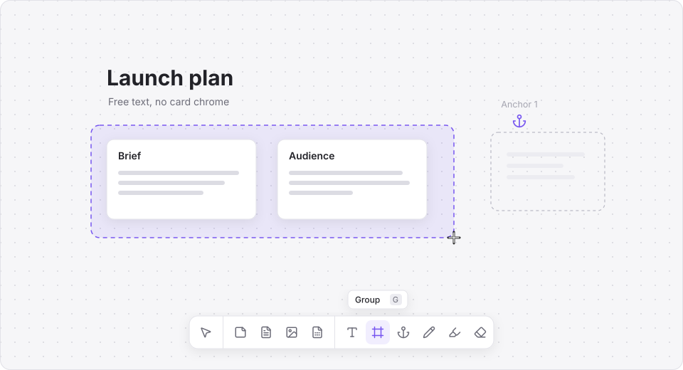
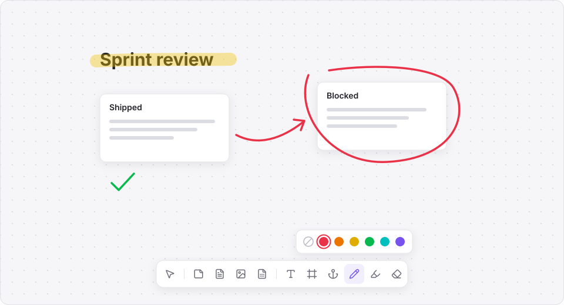
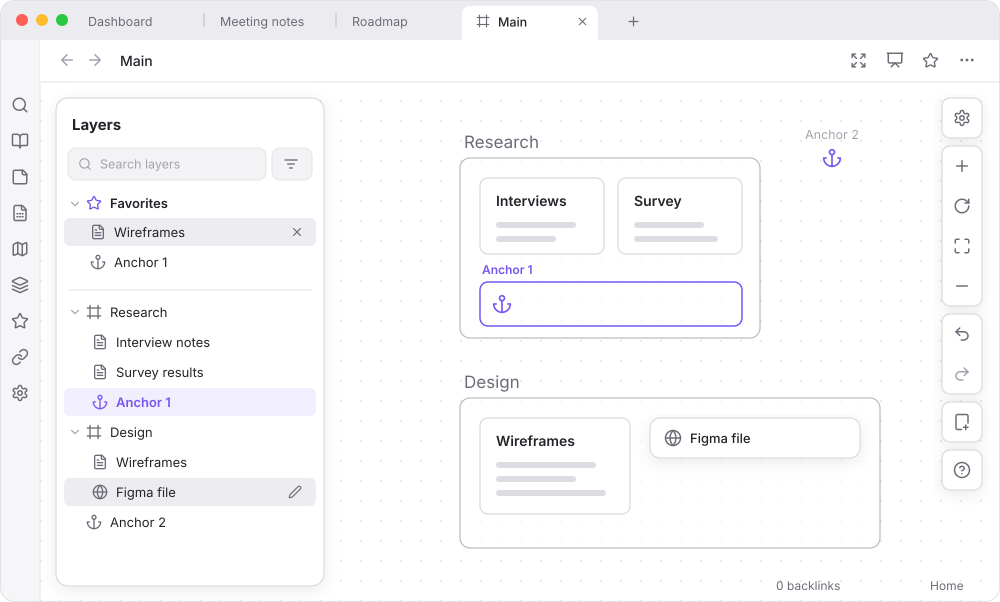
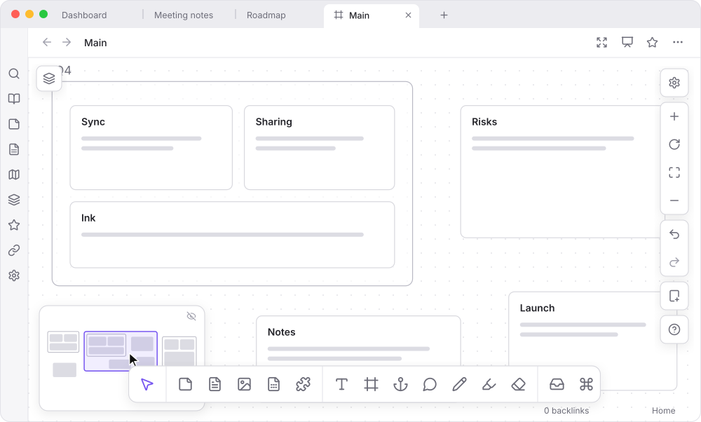
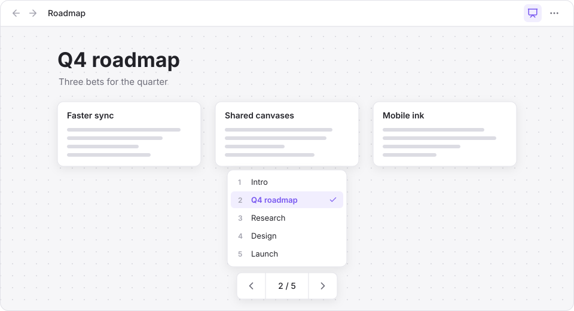
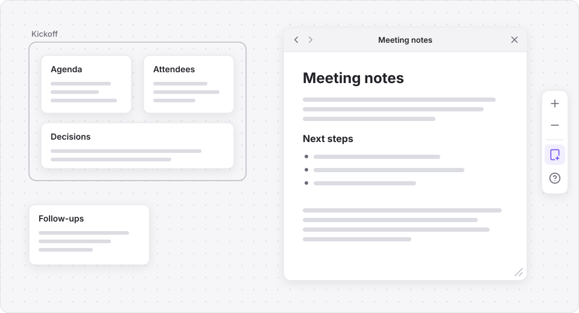
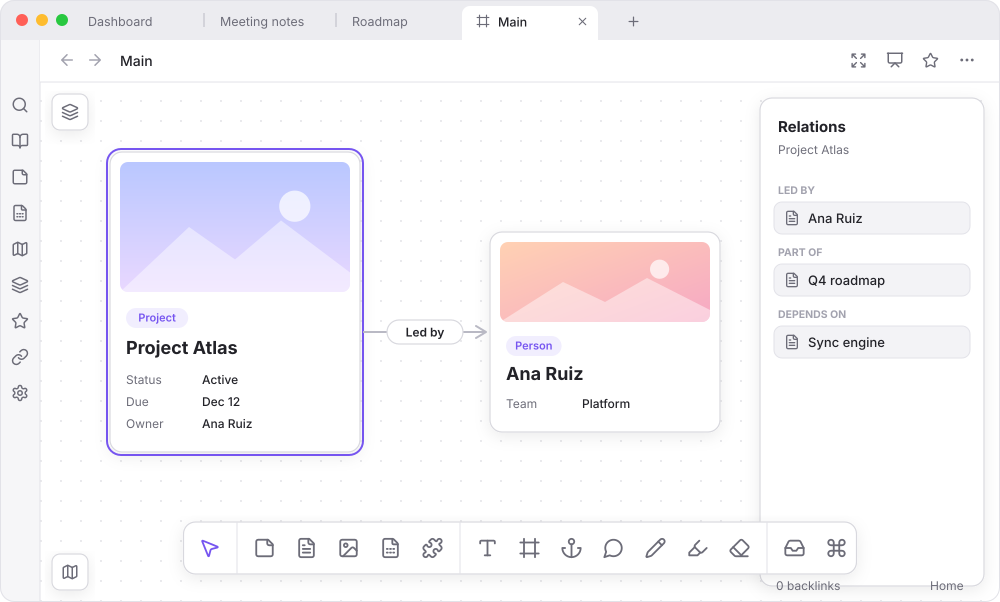

> Readme and promotional images generated by Claude

# Canvas Plus — Obsidian Plugin



Drawing and layout tools for Obsidian's canvas. Paired with the [Note Types](https://github.com/jsmorabito/obsidian-note-types) plugin, typed notes become cards and edges between them become relations.

---

## Features

**Tools in one bar**  
Open a canvas and Obsidian's bottom menu becomes one bar: Select, then its own draggable Card, Note and Media buttons and a draggable **Add note** (`N`) button, then Text (`T`), Group (`G`), Anchor (`A`), Comment (`K`), Marker (`M`), Highlighter (`⇧M`) and Eraser (`E`). `Esc` cancels. Click Text or Group, then click or drag on the canvas to place one. Free text has no card chrome and removes itself if left empty. Click Anchor, then click on the canvas to drop an anchor icon, or drag to draw a frame: the area a presentation shows at that stop. A frame lets clicks through until it is selected, like a core group, but holds nothing. An anchor's name sits above it like a group's label and stays readable at any zoom; drag the name to move it and double-click it to rename it. New anchors are numbered (Anchor 1, Anchor 2…). Click Comment, then click on the canvas to drop a comment pin and type its first message (`Enter` sends). A pin shows as a small bubble; hover it to preview the thread, select it to open the thread to reply to, resolve (resolved pins fade) or delete. Drag a pin to move it: let go over a node and the pin attaches to it (the node is outlined while you carry it) and moves with it; let go on empty canvas and it stays put. A new pin attaches to the node you click on, too. Drag a pin onto the tray to hold it, thread and all, and drag its card back onto the canvas to drop it again. Comments are saved in the canvas file, and undo covers them. The tools also work in a canvas popped out into its own window.



**Ink**  
Marker and highlighter strokes, with a pen color row (none plus the six canvas presets). The eraser removes whole strokes.



**Layers panel**  
A panel on the left lists groups, anchors and what they contain; select an anchor to jump to it. Hover a group or web link and select the pencil to rename it; a link's name shows in place of its URL. It has a search box and a filter by kind of layer or note type. Filtered to **Anchors**, it lists them numbered in presentation order instead; drag a row to reorder them (on touch, hold the row first). It starts hidden: select the layers button in the top left to show it.



**Minimap**  
An overview of the whole canvas in the lower left, with a box for the part in view. Select or drag on it to move the view. It starts hidden: select the map button in the lower left to show it, and the button in its corner to hide it again.



**Presenting**  
Select the presentation button in the view header, next to core's view buttons, or run **Toggle presentation**, to step through the canvas's anchors like slides, in the order set in the layers panel (or top to bottom, then left to right), starting from the selected anchor or the first. Each stop shows its frame, or else the smallest group around its anchor, or centres an anchor outside any group, and the view eases there as it does for core's zoom to selection (at once if your system asks for reduced motion). Move with the arrow keys, Space and Shift+Space, or Page Up and Page Down, or with the bar at the bottom; select the count, or press `G`, for a menu of every stop. `Esc` or the header button ends it, leaving the view where it is. While presenting, the canvas is read-only (core's lock) and the panels, menus and anchors are hidden. **Next presentation stop** and **Previous presentation stop** are commands too, so they can be given hotkeys, for a presentation clicker.



**Focusing**  
Select the focus button in the view header, next to the presentation button, or run **Toggle canvas focus**, to let the canvas fill the window: the ribbons, sidebars, tab bars, status bar and any other tabs are hidden, leaving the canvas and its view header. Select it again, or press `Esc` with nothing selected, to bring them back. A canvas in a sidebar can't be focused; move it into the main area first. The window stays as it is; it isn't full screen. Opening another tab or a sidebar view brings them back too.

**Tray**  
The tray button sits in the bottom toolbar, after the eraser, and the tray opens just above the toolbar. Drag anything on the canvas and the tray appears as a drop zone (or, while it's open, drop straight onto it): drop it there to hold it for later as a small card, and the tray stays open to show it. A group goes in with everything inside it, and edges between the things held come back with them. A tab panel goes in too when you drag it there by its header, and opens again where you drag its card back out. Drag a card back onto the canvas to put it back where you drop it. Select the tray button to keep the strip open and see what it holds, and again to close it. What the tray holds is saved in the canvas file, and undo puts things back.

**Tab panels**  
Select **Add panel** above the help button in the controls on the right to open a new tab floating over the canvas. It starts on the new tab screen and works like any tab: create a note, go to a file, follow links, go back and forward. Its new tab screen also has **Open widget**, a searchable list of the views core and community plugins add, such as the outline, graph view or bookmarks, to open in the panel. Drag its header to move it and drag an edge or corner to resize it. Panels float above the canvas, not on it, so the canvas pans and zooms underneath. Each canvas remembers its panels, where they sit and what they show, and brings them back when you open it again. Close one with the × at the right end of its header.



**With Note Types**  
These need the [Note Types](https://github.com/jsmorabito/obsidian-note-types) plugin enabled. Without it, the rest of Canvas Plus works as usual.

- **Note cards.** Typed notes appear as cards showing an optional key image, the title and any properties you list under **Canvas card fields** for that note type (in Note Types' settings). A button in the selection toolbar, or the **Cycle selected canvas note cards between card, embed and styled link** command, switches a card to a full embed or to a styled link, the same pill the editor shows.
- **Add note (`N`).** Add a typed note to the canvas, or create a new note of a type and its card in one step.
- **Relations on edges.** Connect two cards to choose a relation, which is written to both notes' frontmatter. Select a card to see its relations in a side panel.
- **Key images.** Drop an image on a card to set its key image.
- **Undo covers the notes too.** Undo and redo cover the note changes that relations and key images make, not only the canvas.



**Actions panel (`⌘K`)**  
The **Actions** button in the bottom bar (or `Cmd`/`Ctrl` + `K`) opens a searchable list of actions: the Linear and Task App ones, and a shortcut to this plugin's settings. The ⌘ button sits beside the tray's button. Arrow keys move, `Enter` runs, `Esc` closes.

**With Linear**  
These are in beta and off by default: turn on **Enable Linear integration (beta)** under **Settings → Canvas Plus**, then sign in. Create an OAuth app in Linear (**Settings → API**), give it the callback URL shown there (`obsidian://canvas-plus-linear`), and enter its client ID. Sign-in uses PKCE, so there is no client secret, and the tokens are kept in Obsidian's secret storage. A personal API key works instead.

- **Add Linear issue (`I`).** Search Linear, or enter an identifier like `ENG-123` or an issue's URL, to add the issue to the canvas. Find it in the **Actions** panel too. An issue already on the canvas is selected instead of added twice.
- **Create issues from cards.** Select one or more cards and choose **Create Linear issue** in the selection toolbar. A card's first line becomes the title and the rest its description; pick the team and the card turns into the issue. Undo puts the card back, but the issue stays in Linear.
- **Linear widget.** **Open Linear panel** in the actions panel (or **Open widget** in a new tab panel) opens Linear in a tab panel over the canvas. **On canvas** lists the issues already on this canvas (select one to zoom to it), and **Explore** searches Linear or lists recently updated issues, and adds one with a click.
- **Card, embed or link.** Issues switch between views the same way note cards do (the toolbar button, or the **Cycle selected canvas note cards and issues between card, embed and link** command): a card with the status, assignee and labels, the full issue with its properties and description, or a one-line link. **Open in Linear** is in the toolbar too.

Canvas files stay standard JSON Canvas, with extra fields kept alongside, so stock Obsidian still opens them.

This relies on Obsidian's undocumented canvas internals, collected in `src/canvas/adapter.ts` (and, for tab panels, workspace internals in `src/canvas/hosted-leaf.ts`), and last checked against Obsidian 1.14.4, and may need a patch after an Obsidian update.

---

### Discourse Graphs

With the Discourse Graphs plugin enabled (and nothing to set up), Canvas Plus adds:

- **Create discourse node** (`D`, the toolbar button, the Actions panel or a command): type a title, pick the node type, and the new node's card lands on the canvas, made with that type's folder, name format and template.
- **Discourse context panel** (Actions panel or a command): opens Discourse Graphs' panel as a widget and keeps it on the selected card's node.
- **Convert to discourse node…** in the selection toolbar and the Actions panel, and the node types in the Convert picker.

Nothing is added while Discourse Graphs is off.

## Installation

1. Copy `main.js`, `manifest.json`, and `styles.css` into `<Vault>/.obsidian/plugins/canvas-plus/`.
2. Reload Obsidian.
3. Enable **Canvas Plus** under **Settings → Community plugins**. Enable [**Note Types**](https://github.com/jsmorabito/obsidian-note-types) too for note cards and relations.

---

**With Task App**  
Task App is the self-hosted task app in `Task-App-1.0`. Its integration is in beta and off by default, and does the same as Linear's: turn on **Enable Task App integration (beta)** under **Settings → Canvas Plus**, enter the **Server address** (such as `https://tasks.example.com`, or `http://localhost:4100`), and set the **API token**, which is the server's `API_TOKEN` and is kept in Obsidian's secret storage. A local server with sign-in off needs no token. If the web app runs somewhere else than the API (`http://localhost:3100` while developing), enter it as the **Web app address** so issue links open there. The server must be a version that accepts its API token on `/trpc`.

- **Add Task App issue (`J`)**, **Create Task App issue** in the selection toolbar, the **Task App widget**, and the card, embed and link views all work as they do for Linear. Both can be on at once, and a canvas can hold issues from each. Task App has a single owner, so its cards never show an assignee.

## Network use

The plugin has no telemetry and collects no data. It makes no requests unless you sign in to Linear, set a Linear API key, or turn on Task App. With a Linear sign-in or key, it sends requests to Linear (`api.linear.app`) to search issues, load the issues shown on your canvases (their title, status, assignee, labels and description), and create issues from cards. What is sent for a new issue is the title and description you confirm in the dialog. Nothing else from your vault leaves your device. Issue cards load again from Linear a few minutes apart while a canvas is open. With Task App turned on, the same things (searching, loading the issues shown on your canvases, and creating issues from cards) go to the server address you set, with your API token, and nowhere else.

If a note's key image is a web address, Obsidian loads it from that address whenever a note card shows it. That is a request from your device to the image's host, the same as for any image embedded from the web. Dropping an image link onto a note card only writes the link into the note, and downloads nothing. Dropping an image file saves a copy in your vault's attachment folder, as Obsidian does for any attachment.

---

## For developers: the Note Types API

Canvas Plus talks to [Note Types](https://github.com/jsmorabito/obsidian-note-types) only through the API Note Types publishes on its plugin instance (`app.plugins.getPlugin('filtered-file-commands').api`, defined in Note Types' `src/api.ts`). The bridge is `src/note-types.ts`: it looks the API up on every use, checks its `version`, and falls back to a stand-in where no note has a type.

---

## Development

```bash
npm install
npm run dev      # watch mode
npm run build    # type-check + production bundle
npm run lint     # ESLint
```

Output artifacts (`main.js`) are written to the plugin root. See [AGENTS.md](AGENTS.md) for conventions.

---

## License

MIT
