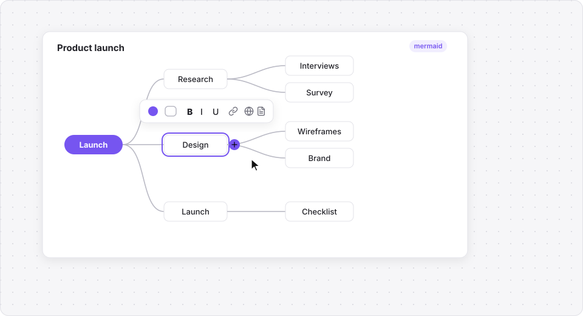
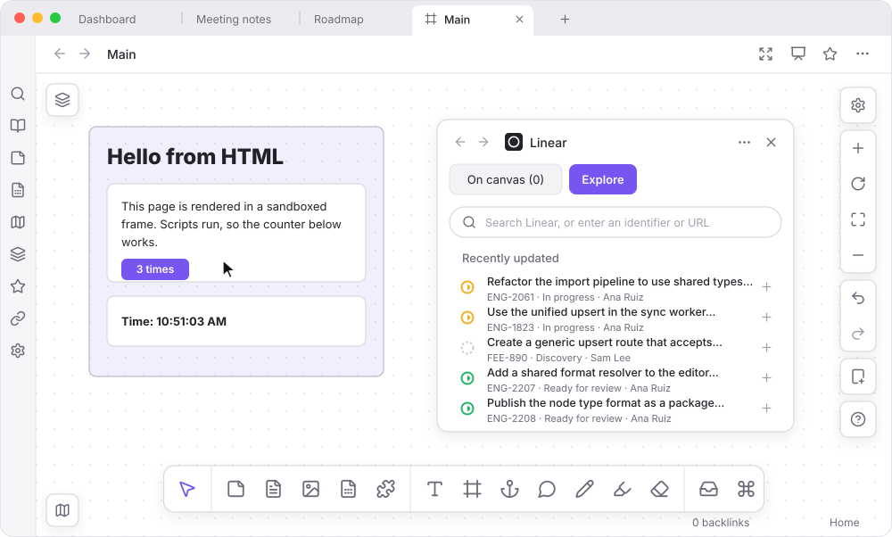
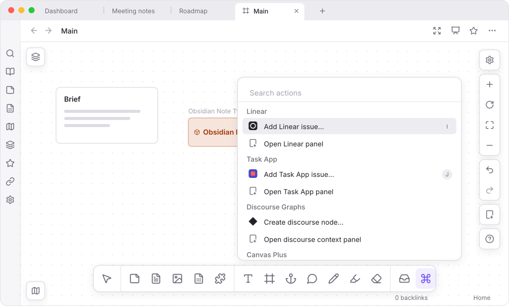

> Readme and promotional images generated by Claude

# Canvas Plus — Obsidian Plugin


Drawing and layout tools for Obsidian's canvas. Paired with the [Note Types](https://github.com/jsmorabito/obsidian-note-types) plugin, typed notes become cards and edges between them become relations.

---

## Features

**Tools in one bar**  
Obsidian's bottom menu becomes one bar: Select, draggable Card, Note, Media and **Add note** (`N`), then Text (`T`), Group (`G`), Anchor (`A`), Comment (`K`), Marker (`M`), Highlighter (`⇧M`) and Eraser (`E`). `Esc` cancels. Click a tool, then click or drag on the canvas to place one. Works in popped-out windows too.

- **Text** has no card chrome and removes itself if left empty.
- **Anchors** are icons, or frames if you drag: the area a presentation shows at that stop. Names are numbered, readable at any zoom, and renamed by double-click.
- **Comments** are pins with threads: reply, resolve, delete. A pin dropped on a node moves with it. Saved in the canvas file; undo covers them.


**Diagrams**  
**Add diagram…** (`B`, or in the actions panel) adds a [Mermaid](https://mermaid.js.org) diagram: mindmap, flowchart, sequence, state, class, ER, Gantt, timeline, kanban, pie, quadrant, XY chart or git graph. [Pele](https://pele.run) draws it in your theme's colors. The source is saved as a `mermaid` code block, so it still renders without this plugin. Double-click to edit the source with a live preview; right-click to copy or save as Mermaid or SVG.

*Mindmaps* and *flowcharts* are editable on the canvas: pick a node, use the dots round it (or `Tab`/`Enter`) to add nodes, double-click or `F2` to rename, drag to rearrange, `Delete` to remove. A toolbar sets color, shape, formatting and wikilinks, and **Link to web address…** turns a node into a link. With Note Types, Discourse Graphs, Linear or Task App on, it can make a note, node or issue from a node's text. Flowcharts using syntax the editor can't change safely stay editable as source.



**Ink**  
Marker and highlighter strokes with a pen color row. The eraser removes whole strokes.


**Layers panel**  
Lists groups, anchors and what they hold. Search, filter by kind or note type, rename with the pencil, and pin **Favorites** at the top. Filtered to **Anchors**, drag rows to set presentation order. Drag its edge to resize (double-click to reset). Starts hidden: select the layers button top left.


**Minimap**  
An overview of the canvas in the lower left, with a box for the part in view. Select or drag to move the view. Starts hidden: select the map button.


**Signposts**  
Use an object's signpost button to pick a next and previous object on the canvas. Step buttons then jump between them, even on a locked canvas. Mindmap and flowchart nodes work too.

**Presenting**  
Select the presentation button in the view header, or run **Toggle presentation**, to step through anchors like slides, in layers-panel order. The view eases to each stop; the canvas is read-only and panels are hidden. Use arrow keys, Space, Page Up/Down or the bottom bar; `G` lists every stop; `Esc` ends. **Next/Previous presentation stop** are commands, so a clicker can drive them.


**Focusing**  
The focus button in the view header (or **Toggle canvas focus**) hides ribbons, sidebars, tabs and the status bar so the canvas fills the window. Select it again or press `Esc` to bring them back. Not available in a sidebar.

**Tray**  
Drag anything toward the tray button after the eraser and drop it in the strip to hold it as a small card: groups with their contents, edges between held things, tab panels, comment pins. Drag a card back to place it. Saved in the canvas file; undo covers it.

**Tab panels**  
**Add panel** (right-hand controls) floats a tab over the canvas. It works like any tab, and **Open widget** lists views from core and community plugins (outline, graph, bookmarks…). Drag to move, edges to resize. Each canvas remembers its panels.


**Widgets and HTML files**  
**Add widget…** puts any non-file view, such as the Linear panel, on the canvas as a live node. **Add HTML file…** does the same for a vault HTML file, and `![[page.html]]` embeds render too. Nodes take clicks only while selected, so they can still be dragged. HTML files also open in tabs, in a sandboxed frame that can't reach the vault or Obsidian.



**Actions panel (`⌘K`)**  
The **Actions** button (or `Cmd`/`Ctrl` + `K`) opens a searchable list: **Add diagram…**, **Add widget…**, **Add HTML file…**, **Convert to…**, the Linear, Task App and Discourse Graphs actions, and plugin settings.



**With Note Types**  
Needs the [Note Types](https://github.com/jsmorabito/obsidian-note-types) plugin. Without it, everything else works as usual.

- **Note cards** show a key image, title (with the type's link icon if enabled) and properties from **Canvas card fields**. Switch to a full embed or styled link from the selection toolbar.
- **Add note (`N`)** adds a typed note, or creates one and its card.
- **Relations on edges.** Connect two cards to choose a relation, written to both notes. Select a card for its relations panel; **Mark as…** adds a relation and the note's card in one step.
- **Key images.** Drop an image on a card.
- **Undo** covers the note changes too.
- **Convert to…** turns selected text cards into notes of a type: first line is the title, the rest the description.


**With Linear**  
Beta, off by default. Turn on **Enable Linear integration (beta)** under **Settings → Canvas Plus** and sign in: create an OAuth app in Linear (**Settings → API**) with callback `obsidian://canvas-plus-linear` and enter its client ID (PKCE, no secret; tokens in Obsidian's secret storage), or use a personal API key.

- **Add Linear issue (`I`)** by search, identifier (`ENG-123`) or URL.
- **Create issues from cards** in the selection toolbar. Undo restores the card but not the issue.
- **Linear widget** (**Open Linear panel**): **On canvas** lists this canvas's issues, **Explore** searches or lists recent ones and adds with a click.
- **Card, embed or link** views, switched like note cards, plus **Open in Linear**.

**With Task App**  
Beta, off by default. Turn on **Enable Task App integration (beta)**, enter the **Server address** and **API token** (the server's `API_TOKEN`, kept in secret storage; none needed for a local server with sign-in off). Set a **Web app address** if the web app runs elsewhere. Needs a server that accepts its token on `/trpc`.

It works like Linear: **Add Task App issue (`J`)**, create from cards, widget, card/embed/link views. Both can be on at once. Task App cards never show an assignee.

**With Discourse Graphs**  
Nothing to set up; these appear when the plugin is on.

- **Create discourse node (`D`)** via toolbar, actions or command: title and type, made with that type's folder, name format and template.
- **Discourse context panel** follows the selected card's node.
- **Convert to discourse node…** in the selection toolbar and actions.

Canvas files stay standard JSON Canvas, with extra fields kept alongside, so stock Obsidian still opens them.

This relies on Obsidian's undocumented canvas internals, collected in `src/canvas/adapter.ts` (and `src/canvas/hosted-leaf.ts` for tab panels), last checked against Obsidian 1.14.4, and may need a patch after an Obsidian update.

---

## Installation

1. Copy `main.js`, `manifest.json`, and `styles.css` into `<Vault>/.obsidian/plugins/canvas-plus/`.
2. Reload Obsidian.
3. Enable **Canvas Plus** under **Settings → Community plugins**. Enable [**Note Types**](https://github.com/jsmorabito/obsidian-note-types) too for note cards and relations.

## Network use

No telemetry, no data collected. No requests are made unless you sign in to Linear, set a Linear API key, or turn on Task App.

- **Linear** (`api.linear.app`): searching issues, loading the issues on your canvases (title, status, assignee, labels, description), and creating issues from the title and description you confirm. Cards refresh every few minutes while a canvas is open.
- **Task App:** the same, to the server address you set, with your API token.
- **Diagrams:** no requests. Clipboard and SVG writes happen only when you choose them, and web links open only on `Cmd`/`Ctrl` + click or a second click on a picked node.
- **Key images:** a web-address image loads from its host whenever a card shows it, as any embedded web image does. Dropping an image link only writes the link; dropping a file saves a copy in your attachment folder.

---

## For developers: the Note Types API

Canvas Plus talks to [Note Types](https://github.com/jsmorabito/obsidian-note-types) only through the API Note Types publishes on its plugin instance (`app.plugins.getPlugin('filtered-file-commands').api`, defined in Note Types' `src/api.ts`). The bridge is `src/note-types.ts`: it looks the API up on every use, checks its `version`, and falls back to a stand-in where no note has a type.

---

## Development

```bash
npm install
npm run dev      # watch mode
npm run build    # type-check + production bundle
npm run lint     # ESLint
npm test         # tests for the diagram source editing
```

Output artifacts (`main.js`) are written to the plugin root. See [AGENTS.md](AGENTS.md) for conventions.

---

## License

MIT. Diagrams are drawn by [Pele](https://pele.run) (MIT), and ink by [perfect-freehand](https://github.com/steveruizok/perfect-freehand) (MIT).
